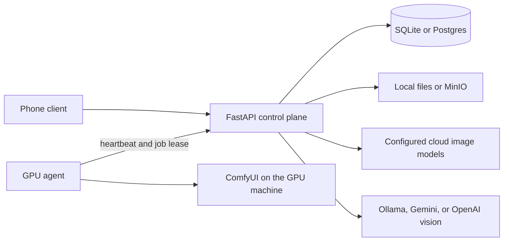
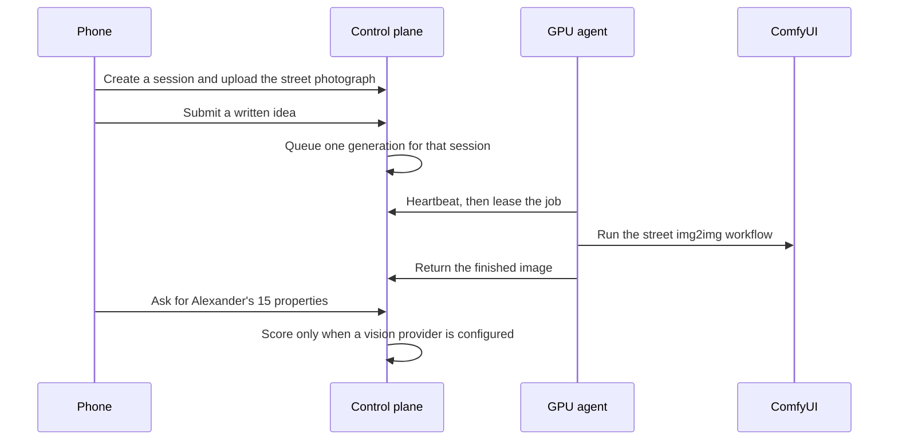

<p align="center">
  
</p>

<h1 align="center">Street Cloud</h1>

<p align="center">
  A camera-driven street redesign control plane.<br>
  Photograph a street, describe a change, generate a new view, and read it against Alexander's 15 properties of living structure.
</p>

<p align="center">
  <a href="https://www.python.org/"></a>
  <a href="https://fastapi.tiangolo.com/"></a>
  
  
  
  
</p>

<p align="center">
  <b>AI-Assisted Co-Urban Designer</b><br>
  SmartMind UI &amp; AI Group · Urban Simulation Lab<br>
  Department of Town &amp; Country Planning · University of Moratuwa, Sri Lanka
</p>

Street Cloud keeps the phone thin. The API owns sessions, photographs, generation jobs, the word cloud, and Alexander scoring. A private GPU machine dials out to the API. It never waits for the phone to open a port, and a private job is never silently handed to a cloud model.

The phone client is a separate repository: [Street Cloud mobile app](https://github.com/sandaru01-IH/streetcloud-frontend---mobile-application).

## What this service does

| Concern | Where it lives |
| --- | --- |
| Accounts, sessions, invites, and revisions | `services/api` |
| Source upload, signed media, and exports | `services/api` |
| Idea capture and the word cloud | `services/api` |
| Image generation policy | Cloud provider, hosted GPU, or private ComfyUI |
| Alexander's 15 properties | A separate vision step. Missing scores stay empty. |
| Private GPU execution | `services/worker-agent`, outbound only |

Demo and mock images stay labeled `DEMO / MOCK RESULT`. Fixture scores are allowed only on demo sessions, and they say they are fixtures. A null score is not filled in.

## Architecture



The agent calls the API. The API does not call back into a private network. Hosted GPU is selectable only after `HOSTED_GPU_ENDPOINT` is set. If the private worker drops, the job stays queued or becomes `worker_disconnected`.



## Repository

```text
services/api            FastAPI control plane, persistence, providers, tests
services/worker-agent   Outbound GPU process and the ComfyUI workflow
docs                    Operations, pairing, threat model, and decisions
scripts                 Local setup and checks
docker-compose.yml      Optional Postgres, Redis, and MinIO
```

## Run it

Python 3.12 or newer. From the repository root:

```powershell
python -m venv .venv
.\.venv\Scripts\python.exe -m pip install -e "services/api[dev]"
copy .env.example .env
.\.venv\Scripts\python.exe -m uvicorn app.main:app --app-dir services\api --host 0.0.0.0 --port 8000
```

`GET /health` answers with the database, storage backend, and whether the embedded worker is on.

```json
{"status":"ok","database":"ok","storage":"local","environment":"local","embeddedWorker":true}
```

On macOS or Linux, use `.venv/bin/python` and `cp .env.example .env`.

Default persistence is SQLite plus local files under `data/`. Compose is optional:

```powershell
docker compose up -d
```

Point `DATABASE_URL` at Postgres and set `STORAGE_BACKEND=s3` only when you want that stack. See [docs/operations.md](docs/operations.md).

Checks:

```powershell
.\scripts\verify.ps1
```

## Private GPU

Register a server from a signed-in account. The device token is shown once. On the GPU machine:

```powershell
$env:PYTHONPATH = "services\worker-agent"
.\.venv\Scripts\python.exe -m streetcloud_agent setup --api http://127.0.0.1:8000 --token YOUR_TOKEN --comfy http://127.0.0.1:8188
.\.venv\Scripts\python.exe -m streetcloud_agent doctor
.\.venv\Scripts\python.exe -m streetcloud_agent connect
```

`streetcloud_agent status` prints the configuration without the token. Pairing rules are in [docs/pairing.md](docs/pairing.md). `STREETCLOUD_AGENT_MOCK=1` is only for a labeled demo. The agent does not fall back to a cloud provider.

## API surface

All routes are under `/api/v1` except `GET /health`.

| Area | Methods |
| --- | --- |
| Auth | `POST /auth/register`, `/auth/login`, `/auth/guest`, `/auth/refresh`, `/auth/logout` |
| Account | `GET /me`, `DELETE /me` |
| Providers | `GET /providers/image`, `GET /providers/evaluation` |
| Sessions | create, list, read, patch, delete |
| Photograph | `POST /sessions/{id}/source-upload` and `/source-upload/complete` |
| Ideas | `POST /sessions/{id}/feedback`, `GET /sessions/{id}/wordcloud` |
| Versions | `GET /sessions/{id}/versions`, publish, export |
| Generation | start, read, and `POST /generations/{id}/cancel` |
| Scores | `POST` and `GET /versions/{id}/evaluations` |
| Workers | register, pair, unpair, health |
| Agent | `POST /agent/v1/heartbeat`, `/jobs/lease`, output, fail |
| Media | signed `GET /media/{id}` and `PUT /uploads/{id}` |

Provider keys stay in the API environment. They are never part of the phone bundle.

## Configuration

Copy `.env.example`. Leave a provider key and its model id empty until that provider should be called. An empty pair means "not configured".

| Variable | Role |
| --- | --- |
| `DATABASE_URL` | SQLite by default. Postgres when Compose is in use. |
| `STORAGE_BACKEND` | `local` or S3-compatible storage. |
| `JWT_SECRET` | Signing secret. Replace the placeholder before any shared deployment. |
| `PUBLIC_BASE_URL` | Base used for media links the phone can open. |
| `OPENAI_API_KEY`, `GOOGLE_API_KEY` | Optional cloud providers. |
| `HOSTED_GPU_ENDPOINT` | Required before hosted GPU can be selected. |
| `OLLAMA_BASE_URL`, `OLLAMA_VISION_MODEL` | Local vision scoring. |
| `COMFY_URL` | ComfyUI address used by the API host when relevant. |
| `RETENTION_DAYS` | Pilot default is 90. Deleting a session removes its stored images. |

## Design rules

These are enforced in the service, not only in the interface.

- A private GPU job stays queued or becomes `worker_disconnected`. It does not switch to a cloud provider.
- Hosted GPU appears only after `HOSTED_GPU_ENDPOINT` is set.
- Demo and mock images stay labeled `DEMO / MOCK RESULT`.
- Alexander scores are not fabricated. Fixture scores exist only on demo sessions and are marked as fixtures.
- One active generation runs per session. A newer idea waits until the current job finishes.
- Signed media links expire. The phone does not receive a standing storage credential.

Further reading: [operations](docs/operations.md), [threat model](docs/threat-model.md), and the decision records in [docs/adr](docs/adr).

## Affiliation

SmartMind UI & AI Group | Urban Simulation Lab  
Department of Town & Country Planning  
University of Moratuwa, Sri Lanka

Developed by Sandaruwan Sankalpa  
Department of Town & Country Planning, University of Moratuwa, Sri Lanka
